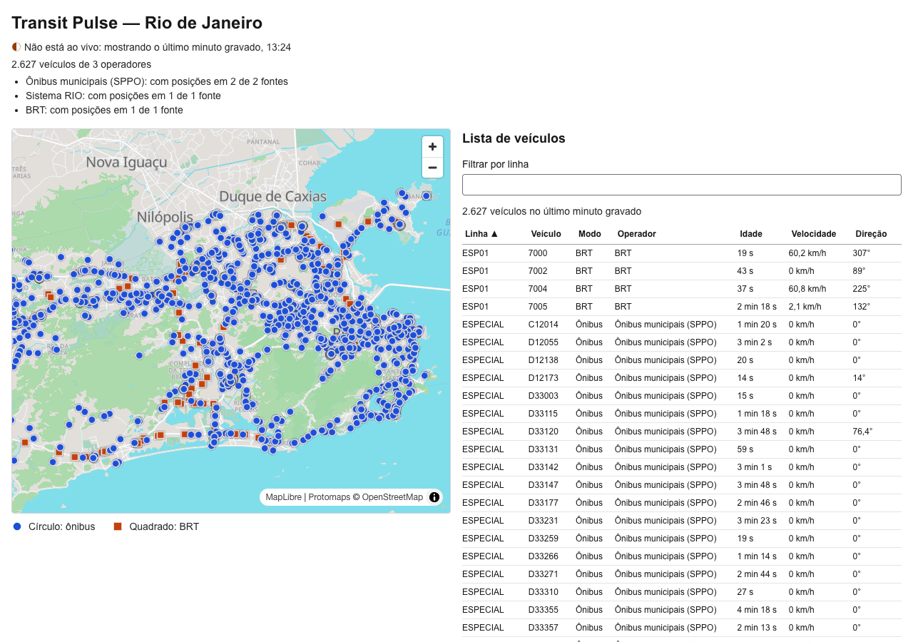

# TASK: The first screen: a Rio map with buses and BRT, a table, and a read-only API

**Status (2026-10-12): Part A and Part B done (§7).** Written for Sonnet sessions to execute. It has two parts:

- **Part A (§2.2, web only)** has no dependency and **can run in parallel** with
  `docs/tasks/TASK-positions-consumer.md`. It puts the Rio basemap on screen.
- **Part B (§2.3–§2.5)** needs the consumer task merged first, because it reads the
  `positions` and `feed_status` tables. It puts the vehicles and the table on screen.

Read `CLAUDE.md`, the user's global `~/.claude/CLAUDE.md` (the frontend rules), and
`apps/web/AGENTS.md` first.

## 0. Rules for whoever executes this

- **Next.js 16 is newer than your training data.** Before writing any Next.js code, read the
  matching guide in `apps/web/node_modules/next/dist/docs/` (`apps/web/AGENTS.md`).
  `cacheComponents: true` is on in `next.config.ts`.
- **Check every library against its own current docs before installing it** (CLAUDE.md §2.0):
  MapLibre GL JS, deck.gl, react-map-gl, pmtiles, `@protomaps/basemaps`, TanStack Table and
  Vitest. Install with `pnpm --dir apps/web add …`, never by editing `package.json` by hand.
  Each `[VERIFY]` is resolved in §7 with a link.
- **Real data only (invariant 1).** The map and table show rows from the database, never a
  fixture, mock or generated vehicle. Part A ships **no vehicles at all**. During development,
  the database is filled from the real recorded run with `make rebuild` (§2.5). Nothing is
  interpolated or animated between fixes.
- **The frontend rules in `~/.claude/CLAUDE.md` apply as written:**
  - Server Components by default, with `'use client'` only at the leaves;
  - every hook wrapped in a named hook in `apps/web/hooks/`, and one `queryOptions` factory per
    endpoint;
  - no `useMemo`/`useCallback`/`React.memo` unless profiling shows a problem;
  - `useEffect` only to sync with an external system;
  - a maintained library over a hand-rolled widget;
  - WCAG 2.2 AA.
- **When running in parallel with the consumer task (Part A),** touch only `apps/web/**`,
  `.gitignore`, the `tiles` Makefile target and this document. Stage files by path, never
  `git add -A`. Shared docs (`CLAUDE.md`, `README.md`, `docs/architecture.md`) are updated in
  Part B.
- When a part is done: fill its §7 section, run `make lint` and `make test` (and
  `make web-build`), and commit **without a `Co-Authored-By` trailer**. Don't push.

## 1. Current scenario

- `apps/web` is the `create-next-app` output plus the TanStack Query provider. `page.tsx` is
  still the starter page, and there is no map.
- The consumer task (planned, in `TASK-positions-consumer.md`) creates two tables:
  - `positions`, one row per fix, keyed `(operator, feed, vehicle, event_time)`, kept 3 days;
  - `feed_status`, one row per `(feed, minute_utc)` holding `ok`, `provider_not_ok`, `failed`
    or `gap`.
  - It also adds `make rebuild`, which fills both tables from the raw log.
- **The real 118-minute run** (2026-10-12 14:27–16:24 UTC) is on disk at
  `var/runs/20261012-its-adapter-raw/`. Rebuilt into the database, it gives a real screen
  without any live run.
- **Operators today** (`packages/its` mapping table):

  | Operator | Mode | Human label |
  |---|---|---|
  | `rio-sppo` | bus | Ônibus municipais (SPPO) |
  | `rio-sistema-rio` | bus | Sistema RIO |
  | `rio-brt` | brt | BRT |

  - `rio-sppo` has two feeds (`its:conecta` and `its:zirix`) that report the same buses from
    different devices (architecture §10 #9).
- Decided and not reopened: MapLibre GL + deck.gl, a Protomaps Rio `.pmtiles` extract
  (architecture §10 #8), and Go for the API.

## 2. Planned changes

### 2.1 Shape of the result

```
┌───────────────────────────────────────────────────────────────┐
│ Transit Pulse — Rio            Status: live · updated 16:24   │
│ Coverage: SPPO ✓ 2/2 feeds · Sistema RIO ✓ · BRT ✓            │
├─────────────────────────────────────┬─────────────────────────┤
│                                     │ Filter by line [____]   │
│        map (MapLibre + deck.gl)     │ table: line, vehicle,   │
│        ● bus   ■ BRT  (legend)      │ mode, operator, age,    │
│                                     │ speed, heading          │
│                                     │ « 1 2 3 … »             │
└─────────────────────────────────────┴─────────────────────────┘
```

- On narrow screens the table goes below the map.
- The line filter applies to both the map and the table.

### 2.2 Part A: basemap on screen (web only, parallel-safe)

1. **Tiles: `make tiles`.**
   - The target uses the `pmtiles` CLI's `extract` on a Protomaps daily build, writing
     `apps/web/public/tiles/rio.pmtiles`. Add `apps/web/public/tiles/` to `.gitignore`.
   - **bbox:** `-43.80,-23.10,-42.70,-22.45`, meant to cover the city of Rio, Niterói and the
     Baixada. Check it against the municipal boundaries and record the final bbox in §7.
     `maxzoom` is 15.
   - `[VERIFIED in §7: the current build URL, the CLI flags, and how the CLI is installed (a
     released binary, not a hand-written download); record the file size in §7]`.
2. **Range requests:** pmtiles needs HTTP `Range`. Check with
   `curl -s -o /dev/null -w '%{http_code}' -r 0-99 http://localhost:3000/tiles/rio.pmtiles`,
   which must print `206` under `next dev` and under `next start`. **If it doesn't, stop and
   record it.** The fallback is the Go API serving the file through `http.ServeFile`, which
   supports `Range`, in Part B.
3. **Style:** `@protomaps/basemaps` generates the layers, using the `light` flavor and
   Portuguese labels (`lang: "pt"`), on a `pmtiles://` source registered with the `pmtiles`
   protocol for MapLibre.
   - Glyphs and sprites come from Protomaps' hosted assets for now. Self-hosting them is the
     AWS task (architecture §10 #8 already says they must be hosted).
   - `[VERIFIED in §7: the exact style-building API and asset URLs in the @protomaps/basemaps
     docs]`.
4. **Map component:** `apps/web/components/live-map.tsx`, a `'use client'` leaf. It uses
   `react-map-gl/maplibre`, loaded so it never renders on the server `[VERIFIED in §7: the Next 16
   way, e.g. next/dynamic with ssr: false inside a client component]`.
   - Initial view: centre `-43.35, -22.90`, zoom 10.
   - Keyboard: MapLibre's default keyboard handlers stay on. The container gets
     `role="region"` and `aria-label="Mapa de veículos"`, plus a visible focus ring.
   - `prefers-reduced-motion`: no `flyTo`/`easeTo` animations. Jumps only.
5. **Page:** replace the starter `page.tsx` with a Server Component that renders the header,
   an empty status line ("Sem dados de veículos ainda"), the map, and an empty table region
   that says the vehicle list arrives with the API. Remove the starter assets it no longer
   uses. Set `lang="pt-BR"` on `<html>` and a real `<title>` in `layout.tsx`.

**Part A is done when** the Rio basemap renders at `localhost:3000` in `next dev` and
`next build && next start`, with no vehicles and no fake data, and A1–A3 in §5 pass.

### 2.3 Part B: `apps/api` (Go), the read model

- **One binary** that reads the database with pgx and **serves only from memory** (invariant
  5). A refresher goroutine checks every 10 s for a newer `feed_status.minute_utc`. When it
  finds one, it computes the snapshot once, encodes it as JSON plus gzip, and swaps it in
  atomically. A request never runs a query. If the database is down, the last snapshot keeps
  being served, and its `as_of` shows its age.
- **`GET /v1/vehicles/latest`**, response:

  ```json
  {
    "as_of_minute": "2026-10-12T16:24:00Z",
    "generated_at": "2026-10-12T16:25:31Z",
    "window_seconds": 300,
    "coverage": [
      {"operator": "rio-sppo", "mode": "bus", "tier": "live",
       "minute_utc": "2026-10-12T16:24:00Z", "feeds_total": 2,
       "feeds_by_status": {"ok": 2}}
    ],
    "vehicles": [
      {"operator": "rio-sppo", "mode": "bus", "vehicle": "A48011", "line": "457",
       "lat": -22.9, "lon": -43.2, "event_time": "2026-10-12T16:24:41Z",
       "speed_kmh": 31, "heading_deg": null}
    ]
  }
  ```

  - **`as_of_minute`** is the newest `minute_utc` that has at least one `ok` or
    `provider_not_ok` row. That's the newest minute with positions. A newer `failed` or `gap`
    minute shows up in `coverage`, not as zero vehicles (invariant 6).
  - **`vehicles`** holds one row per `(operator, vehicle)`: the newest fix with `event_time` in
    `(as_of_minute + 1 min − 300 s, as_of_minute + 1 min]`.
    - Query: `SELECT DISTINCT ON (operator, vehicle) … ORDER BY operator, vehicle,
      event_time DESC, received_time DESC, feed`.
    - The final `feed` ordering is only a deterministic tie-break; nothing interprets its
      value (§10 #9).
    - A fix older than the window isn't shown. 300 s is a named constant, documented in the
      response as `window_seconds`.
  - **`coverage`** has one entry per operator for its newest minute, counting its feeds by
    status. `feed` itself is never sent. `tier` is `"live"` for all three today; it exists so
    `scheduled` and `none` fit later.
  - `null`s stay `null`. `speed_kmh: 0` means a reported 0.
- **Headers:** `ETag` = `as_of_minute` + `generated_at`, `If-None-Match` → `304`,
  `Cache-Control: public, max-age=10`, and gzip when the request accepts it.
- `GET /healthz`: `200` with the snapshot's age.
- **Config:** `DATABASE_URL` (exists), plus `API_ADDR=127.0.0.1:8080` (new).
  `make api` runs it, loading `.env` as the adapter target does.
- **The web app reaches it same-origin:** a `rewrites()` entry in `next.config.ts` maps
  `/api/:path*` → `http://127.0.0.1:8080/:path*` locally `[VERIFIED in §7 rewrites in the Next 16
  docs]`. So there's no CORS, and production Caddy does the same mapping.
- **Operator labels and modes** live in one Go map in `apps/api`, the only place that turns
  `rio-sppo` into "Ônibus municipais (SPPO)". The response sends a `label` per coverage
  entry.

### 2.4 Part B: web, vehicles and table

- **`apps/web/hooks/use-latest-vehicles.ts`:**
  - a `latestVehiclesQueryOptions` factory (key `["vehicles","latest"]`, `queryFn` fetches
    `/api/v1/vehicles/latest`, `refetchInterval: 30_000`);
  - a `useLatestVehicles()` hook;
  - the business rules, once:
    - `formatAge(event_time, as_of)`;
    - `formatNullable(x)` gives `"—"` for `null`, never `0`;
    - `statusOf(snapshot, now)` gives `live` when `as_of_minute` is ≤ 5 min old, `stale`
      otherwise (with the text "Não está ao vivo: mostrando o último minuto gravado, <time>"),
      and `failed` when coverage says so.
- **Client-side fetch only for this task.** The data changes every minute, and a server
  prefetch would save one request on first paint while fighting Cache Components.
  Recorded as an alternative (§2.6).
- **Vehicles on the map:** a deck.gl `IconLayer` through `MapboxOverlay` (interleaved with
  MapLibre) `[VERIFIED in §7: the current deck.gl + react-map-gl integration]`.
  - Bus is a circle and BRT a square, so the shape carries the mode and colour is not the
    only carrier. Both colours have ≥ 3:1 contrast against the basemap (WCAG 1.4.11).
  - The hover tooltip shows line, vehicle, operator label and age.
  - Positions **snap** on refresh, with no transitions (invariant 1, reduced motion).
- **Legend:** a static HTML list with the same shapes and text labels.
- **Table:** `apps/web/components/vehicle-table.tsx`, built with **TanStack Table** (headless)
  over a native `<table>`, with a `<caption>`, `scope="col"` headers and sort buttons that
  have `aria-sort`.
  - Columns: line, vehicle, mode, operator label, age, speed, heading.
  - 50 rows per page, sorted by line.
  - A text filter by line, with a visible `<label>`, shared with the map through state lifted
    to the client component that wraps both (`vehicle-view.tsx`).
- **Status and coverage strip:** the text described above.
  - It's an `aria-live="polite"` region that announces **only status transitions** (live →
    stale → failed), not every refresh.
  - A total line: "10.412 veículos de 3 operadores".

### 2.5 Part B: dev data, Make and docs

- **Dev data:** `make up && make rebuild FROM=2026-10-12T14:27:00Z TO=2026-10-12T16:24:00Z`
  (the consumer task's target) fills the database from the recorded run, with no live run
  needed. The screen then shows the recording, and `statusOf` labels it "não está ao vivo",
  because its `as_of_minute` is old. With `make adapter-its` and `make consumer` running, it
  shows live data instead. The code is the same either way.
- Makefile targets: `api`, `tiles`. `.env.example` gets `API_ADDR`.
- Docs:
  - `CLAUDE.md`: status, stack table (MapLibre, deck.gl, react-map-gl, pmtiles, TanStack
    Table, Vitest), the §4 tree, make targets;
  - `README.md`: "run it locally" steps;
  - `docs/architecture.md` §5: the API's in-memory snapshot.

### 2.6 Alternatives considered and rejected

- **An API that reads the raw log directly, to avoid waiting for the consumer:** a second
  read path to remove later. Waiting costs nothing, because Part A runs meanwhile.
- **A query per request:** breaks invariant 5 under a traffic spike. The in-memory snapshot
  costs one query per minute.
- **Server-side prefetch with `HydrationBoundary`:** one saved request, more Cache Components
  friction. Revisit if the first paint is slow.
- **Interpolating or animating vehicle movement:** invariant 1.
- **OpenFreeMap tiles:** §10 #8 decided Protomaps.
- **A hand-rolled table or pagination:** the global rule says use TanStack Table.
- **A map-only view:** invariant 7 requires the table.
- **Showing every device (one row per feed):** duplicates 2,072 SPPO buses (§10 #9).

### 2.7 Out of scope

Delays by line and aggregates, route shapes (GTFS `shapes.txt`), the per-operator coverage
panel for phase 2 operators, self-hosted glyphs and sprites, dark-mode basemap, deploy.

## 3. Why

- It's the first thing on screen, and it's built on real recorded data with no live run.
- It proves invariant 5 (readers isolated: one query per minute, everything else from memory),
  invariant 6 (failed ≠ empty in the UI) and invariant 7 (table, shapes, reduced motion).
- **Cost:** about 4 new web dependencies and one Go binary. The `.pmtiles` extract is local
  disk only (size in §7).

## 4. Affected files

| File | Change type | Notes |
|---|---|---|
| `apps/web/app/page.tsx`, `layout.tsx` | edit | A: starter page replaced, `lang`, title |
| `apps/web/components/live-map.tsx` | new | A: basemap; B: vehicle layer |
| `apps/web/components/vehicle-table.tsx`, `vehicle-view.tsx`, `status-strip.tsx`, `legend.tsx` | new | B |
| `apps/web/hooks/use-latest-vehicles.ts` (+ `.test.ts`) | new | B |
| `apps/web/next.config.ts` | edit | B: rewrites |
| `apps/web/package.json`, `pnpm-lock.yaml` | edit | via `pnpm add` only |
| `apps/web/public/` | edit | A: starter assets removed; `tiles/` git-ignored |
| `apps/api/main.go`, `config.go`, `snapshot.go`, `api_test.go` | new | B |
| `apps/api/server.go`, `operators.go` | new | B: the refresher and handlers; the one operator map (not in the plan's list) |
| `apps/web/hooks/use-now.ts`, `use-vehicle-status.ts`, `use-deck-overlay.ts` | new | B: the clock, the status the strip shows, the deck.gl control (each hook wrapped, per the global rule) |
| `apps/web/components/vehicle-style.ts` | new | B: shape and colours shared by the map and the legend |
| `apps/web/vitest.config.mts` | new | B: Vitest, node environment |
| `docs/tasks/assets/live-map-recording.png` | new | B6 screenshot |
| `Makefile`, `.env.example`, `.gitignore` | edit | `tiles` (A); `api`, `API_ADDR`, web tests in `make test` (B) |
| `CLAUDE.md`, `README.md`, `docs/architecture.md` | edit | B |
| `docs/tasks/TASK-live-map.md` | edit | §7 |

## 5. Acceptance criteria

Timings are medians of 3 runs.

**Part A**
- **A1** `make tiles` produces `rio.pmtiles`. The size and the final bbox are in §7. `curl -r`
  returns `206` under `next dev` and `next start`.
- **A2** The basemap renders with Portuguese labels at `localhost:3000` in dev and in
  production builds. The browser console has no errors. `make web-build` and `make lint`
  pass.
- **A3** Accessibility:
  - axe-core reports **0 violations** for the `wcag2a`, `wcag2aa`, `wcag21aa` and `wcag22aa`
    tags `[VERIFIED in §7: run it with @axe-core/cli or the browser extension, whichever is current;
    record how]`;
  - the map region is reachable with Tab and pans with arrow keys;
  - with reduced motion on, no animated camera move happens.

**Part B**
- **B1 API on real data** (Go integration test with `packages/testharness`, filled through the
  consumer task's `store` writes from the captured samples via `packages/its`):
  - the snapshot's vehicle count equals the distinct `(operator, vehicle)` count inside the
    window, computed independently in the test with SQL;
  - a vehicle reported by both SPPO feeds appears **once**;
  - a fix older than 300 s is absent.
- **B2 Failed ≠ empty.** In the test, add a newer `failed` `feed_status` minute. `as_of_minute`
  doesn't move, the coverage for that operator shows `failed`, and the vehicles are
  unchanged.
- **B3 Readers isolated.**
  - While a client sends 1,000 requests, `pg_stat_statements` (or the test's own query
    counter) shows **≤ 1 snapshot query per new minute**.
  - p95 response time ≤ 20 ms for the in-memory snapshot (Go benchmark or a load tool,
    median of 3).
  - With the database stopped, requests still return `200` with the old snapshot.
- **B4 Payload:** the gzip size of the snapshot of the recorded run's last minute is reported.
  **Stop and ask if it's over 500 KB.**
- **B5 Rules tested:** Vitest tests for `formatAge`, `formatNullable` (`null` → `—`, `0` →
  `0`) and `statusOf` (live, stale, failed) `[VERIFIED in §7: the Next 16 Vitest guide]`. The test
  runner is added to `make test`.
- **B6 On screen with the recording:** after `make rebuild` of the 118-minute run, plus
  `make api` and `make web-dev`:
  - the map shows the vehicles, and the status says "não está ao vivo" with 16:24 UTC shown in
    local time;
  - the table total equals B1's count for that minute;
  - filtering by a line updates both the map and the table.
  - Take a screenshot for §7.
- **B7 Accessibility again:** A3's axe run with vehicles loaded gives 0 violations. Tab
  reaches, in order: filter → table sort buttons → pagination, with a visible focus. The
  status announcement fires once on a forced transition, not on every refresh.
- **B8** `make lint` reports 0 issues. `make test` is green with 0 skipped, and its runtime is
  the median of 3. `make web-build` passes. The docs in §2.5 are updated, and
  `grep -n "\[VERIFY" docs/tasks/TASK-live-map.md` lists only items deferred in §7.

## 6. Execution order

1. **Part A** (can start now, in parallel with the consumer task): tiles → range check → style
   → map component → page → A1–A3 → commit.
2. *Wait until `TASK-positions-consumer.md` is merged.*
3. **Part B:** `apps/api` (B1–B4) → hook and rules (B5) → vehicle layer, table, status
   (B6, B7) → docs → B8 → commit.

## 7. Results

### Part A

Done 2026-10-12. Verified in headless system Chrome (Playwright, SwiftShader software GL) driven
from a scratch project outside the repo, with `axe-core` injected. The Claude-in-Chrome
extension wasn't connected.

**Tiles (A1)**

- Source: Protomaps daily build `https://build.protomaps.com/20261012.pmtiles` (138.8 GB, style
  version 4.15.2, from the index at `https://build-metadata.protomaps.dev/builds.json`).
  `make tiles` takes the newest key in that index, because the bucket keeps about a week of
  builds. Override with `make tiles TILES_BUILD=<key>`.
- CLI: `pmtiles` 1.31.2, installed with `brew install pmtiles` (the released binary, bottled).
  Command: `pmtiles extract <build> apps/web/public/tiles/rio.pmtiles --bbox=… --maxzoom=15`.
  Flags checked against [docs.protomaps.com/pmtiles/cli](https://docs.protomaps.com/pmtiles/cli).
- Output: `apps/web/public/tiles/rio.pmtiles`, **44,628,646 bytes (≈ 45 MB)**, 7,688 tile entries,
  54 requests, 47 MB transferred. Two runs took 17.1 s and 18.0 s (not three: the target isn't
  a performance claim). Git-ignored.
- **Final bbox: `-43.80,-23.10,-42.70,-22.45`, unchanged.** Checked against Nominatim
  bounding boxes (OSM): the city of Rio (lon -43.796..-43.099, lat -23.083..-22.746), Niterói,
  São Gonçalo and the Baixada municipalities (Nova Iguaçu, Duque de Caxias, São João de Meriti,
  Belford Roxo, Nilópolis, Mesquita, Queimados, Japeri, Magé, Seropédica) fall inside it.
  Magé (north to -22.484) and Duque de Caxias (-22.476) clear the -22.45 edge. **Itaguaí** (west
  to -43.94) is clipped at -43.80; it's not in the Rio-first scope.

**Range requests (A1):** `curl -s -o /dev/null -w '%{http_code}' -r 0-99 …/tiles/rio.pmtiles`
prints `206` (3 of 3) under `next dev` and (3 of 3) under `next start`. The browser's own range
requests returned `206` as well. The Go fallback isn't needed.

**Libraries (checked against current docs)**

| Package | Version | Notes |
|---|---|---|
| `maplibre-gl` | 6.14.0 | v6 is ESM-only and needs `setWorkerUrl(new URL("maplibre-gl/dist/maplibre-gl-worker.mjs", import.meta.url))` with Turbopack ([MapLibre docs](https://maplibre.org/maplibre-gl-js/docs/)) |
| `react-map-gl` | 8.1.3 | `import { Map } from "react-map-gl/maplibre"` (a wrapper over `@vis.gl/react-maplibre`, which imports `maplibre-gl` itself) |
| `pmtiles` | 4.5.0 | `addProtocol("pmtiles", new Protocol().tile)` ([docs](https://docs.protomaps.com/pmtiles/maplibre)) |
| `@protomaps/basemaps` | 5.7.2 | `layers("protomaps", namedFlavor("light"), { lang: "pt" })` ([docs](https://docs.protomaps.com/basemaps/maplibre)) |

- Glyphs: `https://protomaps.github.io/basemaps-assets/fonts/{fontstack}/{range}.pbf`. Sprite:
  `https://protomaps.github.io/basemaps-assets/sprites/v4/light`. Both hosted by Protomaps for now.
- **Two files, not one:** `components/live-map.tsx` is the `'use client'` wrapper (region, label,
  focus ring) and does `next/dynamic(…, { ssr: false })` (the Next 16 lazy-loading guide says
  `ssr: false` must live in a Client Component). `components/live-map-canvas.tsx` holds the
  MapLibre code, so it only ever runs in the browser.
- The pmtiles protocol is registered once at module scope of the canvas file, not in an Effect.
  The module is loaded only by the dynamic import, and registering before the map exists
  avoids a race with the first tile request. The style's tile URL is absolute
  (`window.location.origin`), because the protocol handler fetches outside the page's base URL.
- Page: Server Component with the header, the status line "Sem dados de veículos ainda", the map
  and an empty table section. `lang="pt-BR"` and a real title are set. The five starter SVGs
  are removed.

**Acceptance**

- **A1** ✅ size and bbox above; `206` under `next start` and `next dev`.
- **A2** ✅ The basemap renders with Portuguese labels (for example "Baía de Guanabara",
  "Região Oceânica") in `next dev` and in `next build && next start`. Console: no errors
  (Chrome's software-GL "GPU stall" performance notices only). `pnpm --dir apps/web lint` and
  `make web-build` pass.
  - **Note:** a screenshot taken before MapLibre finishes drawing shows only the grey
    background. With software GL it needs about 15 s.
- **A3** ✅
  - axe-core (4.x, the `axe-core` npm package injected by Playwright; tags `wcag2a`, `wcag2aa`,
    `wcag21aa`, `wcag22aa`): **0 violations** in both builds.
  - Tab order: map canvas → zoom in → zoom out → attribution button → attribution links. The
    canvas shows a 2 px solid focus outline.
  - Keyboard: with the canvas focused, ArrowRight moves the centre from -43.3500 to -43.2813.
    With normal motion the move animates (30 ms later it hasn't moved; after 1.2 s it has).
    With `reducedMotion: "reduce"` the same key press jumps at once (30 ms later it's already at
    -43.2813). MapLibre honours the setting itself, and we add no animated camera calls.

**Not done / caveats**

- `make test` is red on this tree, and `make lint` was red once and clean once, all in the
  consumer task's **uncommitted, in-progress `packages/store`** (`TestStore` idempotency
  assertions; a `staticcheck` QF1001 at `store_test.go:285`). Part A touches no Go. Every other
  package passes (`go test` on all packages except `packages/store`). Web lint is clean.
- No screenshot is saved in the repo (tiles and vehicles come in Part B's screenshot, B6).

### Part B

Done 2026-10-12. The recorded run was rebuilt into its own database (`transit_pulse_run`, same
TimescaleDB container) so the local `transit_pulse` database keeps the consumer task's live E8 data
untouched: `RAW_DIR=./var/runs/20261012-its-adapter-raw DATABASE_URL=…/transit_pulse_run make
rebuild FROM=2026-10-12T14:27:00Z TO=2026-10-12T16:24:00Z` wrote 1,099,188 rows and 472 statuses (118
of 118 minutes complete, 0 gaps, 33,916 rows/s), the same numbers as the consumer task. To see the
recording again, run `make api` and `make web-dev` with that `DATABASE_URL`.

**`apps/api`**

- Files: `main.go` (wiring, graceful stop), `config.go`, `operators.go` (the one operator map),
  `snapshot.go` (queries, encoding), `server.go` (refresher, handlers), `api_test.go`. It is
  read-only and never migrates. If the database is down at start it still starts, answers `503` with
  `Retry-After`, and keeps retrying.
- **The refresher probes, then queries.** Every 10 s it runs a tiny query on `feed_status` (one row
  per feed, from the primary key). Only when that result differs from the one the snapshot was built
  from does it run the snapshot query, encode JSON and gzip (`BestCompression`, once per change) and
  swap the pointer. The plan said "a newer `feed_status.minute_utc`"; comparing the whole probe
  result also catches a minute that goes `failed` → `ok` at the same `minute_utc`, which a
  max-minute check would miss (tested in B2).
- `as_of_minute` is the newest `minute_utc` with an `ok` or `provider_not_ok` row, taken per feed with
  a correlated `max()` so a newer `failed`/`gap` minute can't move it. `coverage` counts each operator's
  feeds at its newest minute; `feeds_total` counts the feeds known for the operator, so a feed that is
  behind shows as a sum below the total, never as an invented status. An operator with no entry in
  `operators.go` fails the refresh (the old snapshot keeps serving, the log says why) rather than
  getting a guessed label.
- The vehicle's `mode` is the row's own; the coverage's `mode` comes from the operator map. A test
  asserts they agree.
- `ETag` is weak (`W/"<as_of_minute>.<generated_at>"`) because the same snapshot goes out plain and as
  gzip; `If-None-Match` takes lists and `*`. `/healthz` answers `200` while any snapshot exists, with
  `snapshot_age_seconds` and `refresh_ok`. **It does not return the database error**: the pgx text
  contains the user and database name, and `/healthz` is reachable from the site. The reason is in the
  log (one line when it starts or changes, one when it clears).
- The `make api` target, `API_ADDR` in `.env.example` (and in your local `.env`, appended).

**Libraries (checked against current docs)**

| Package | Version | Notes |
|---|---|---|
| `@deck.gl/maplibre` | 9.4.0 | `MapLibreOverlay` via react-map-gl's `useControl`; peer `maplibre-gl ^6` ([docs](https://deck.gl/docs/api-reference/maplibre/overview), [React example](https://deck.gl/docs/developer-guide/base-maps/using-with-maplibre)). Not `@deck.gl/mapbox`: that is the older package and its page says nothing about MapLibre 6 |
| `@deck.gl/core`, `@deck.gl/layers` | 9.4.0 | `IconLayer` |
| `@tanstack/react-table` | 9.2.8 | **v9, not v8**: `useTable({ features, … })` with `tableFeatures({ rowSortingFeature, sortedRowModel: createSortedRowModel(), … })`, `createColumnHelper`, `table.FlexRender`. Read from the skills shipped inside the package (`node_modules/@tanstack/react-table/skills`), because tanstack.com returned 500 |
| `vitest` | 5.0.3 | pure functions, node environment, no jsdom. Next's Vitest guide adds jsdom and React Testing Library for component tests; none are written here, so they aren't installed |
| `@types/node` | 24 | was 20; Vitest 5 asks for `^22 \|\| >=24` (the project runs Node 24) |

- `next.config.ts` `rewrites()`: `/api/:path*` → `http://127.0.0.1:8080/:path*`. Through it, gzip,
  `ETag` and `304` still work (checked with curl on `next dev`).

**Web**

- **Hooks in `apps/web/hooks/`:** `use-latest-vehicles.ts` (one `queryOptions` factory, `refetchInterval:
  30_000`, `select` deriving the rows once per response, the rules `formatAge`, `formatNullable`,
  `statusOf`, `formatCoverage`, `formatTotal`, `filterByLine`), `use-vehicle-status.ts`, `use-now.ts`,
  `use-deck-overlay.ts`. Components call only these.
- **Status.** `failed` wins when an operator's newest minute has no feed with positions; then `stale`
  (newest minute more than 5 min old); then `live`. The strip adds `loading` and `unavailable` (the API
  didn't answer, which is not "no vehicles"). The `aria-live="polite"` region is a separate hidden
  element whose text depends only on the kind, so refreshes don't announce.
- **Age** is counted from the end of the snapshot's minute (the end of the API's window), not from the
  browser's clock, so the recording shows ages under 5 min. A fix after that end shows "—", not 0.
- **Filter:** a case-insensitive *prefix* match on the line (typing "45" finds 455–457, not 1457). A
  vehicle with no line never matches a non-empty filter. State lives in `vehicle-view.tsx`; the same
  filtered array feeds the map and the table, and the page index resets in the same handler.
- **Table:** TanStack Table v9 over a native `<table>`; sort buttons inside each `<th scope="col">`
  (`aria-sort` on the sorted one), 50 rows per page, sorted by line first, `Anterior`/`Próxima`.
  Sorting resets to page 1; a refresh keeps the page (`autoResetPageIndex: false`), clamped if fewer
  pages remain. The wrapper is a focusable `region` so a horizontal scroll is reachable by keyboard.
- **Map:** `IconLayer` (circle = bus, square = BRT) from a canvas atlas drawn once; tooltip on hover
  with line, vehicle, operator label and "Última posição há …". No transitions. Colours `#1d4ed8` (bus)
  and `#c2410c` (BRT) have a contrast of at least **3.95:1 and 3.06:1** against every flavor colour of
  the `light` basemap (background, earth, water, parks, wood, buildings, …), computed from
  `namedFlavor("light")`; the white outline separates them from dark features.
- **Layout:** two equal columns from `lg` up (a 3:2 split clipped the last table column at 1280 px).

**Two bugs found by running it, both fixed**

1. `useNow` read `Date.now()` in a `useState` initializer. Next 16 with Cache Components refuses that
   in a Client Component ("unstable value `Date.now()`"). It is now an external store
   (`useSyncExternalStore`, server snapshot `0`), so the server never reads the clock.
2. deck.gl in **interleaved** mode failed in `next dev` with "WebGL context already attached to
   device": React Strict Mode mounts the control twice and the second attach hits the shared MapLibre
   context. The overlay is now **overlaid** (own canvas); nothing here needs to be depth-sorted into the
   basemap. The overlay canvas also made itself a tab stop with no focus ring (WCAG 2.4.7);
   `use-deck-overlay.ts` sets `tabindex="-1"` and `aria-hidden` from deck's `onLoad` (earlier, deck
   overwrites it). axe passes only once both are set.

**Acceptance**

- **B1** ✅ (`TestSnapshotOnRealData`, real TimescaleDB, the four captured samples written through
  `store` as the single page of minute 13:38). 103 vehicles in the window; the snapshot equals a
  `GROUP BY` + join count and matches each vehicle's newest stored fix (event time, position, nulls). 9
  vehicles have only fixes older than 300 s and are absent. The vehicles reported by both SPPO feeds
  are found by SQL (not named in the test) and appear once, with the newest fix. A reported speed of 0
  stays 0 (31 of them).
- **B2** ✅ A newer `failed` minute: `as_of_minute` and the vehicles don't move, the ETag changes, and
  every operator's coverage shows `failed` at the new minute (`rio-sppo`: 2 failed feeds). Writing the
  same minute as `ok` afterwards moves `as_of_minute` to it.
- **B3** ✅ (`TestReadersAreIsolated`).
  - 1,000 requests ×3 runs ran **0** snapshot queries each. Over the whole test the snapshot query ran
    1 time for the first minute and 2 in total after one new minute, while 4 readers hammered the
    endpoint during the swap. The probe kept running on its own clock (≥ 3 probes).
  - p95 over 1,000 requests, 8 workers, median of 3 runs: **0.3 ms** (103 vehicles, 0.9 ms under
    `-race`). At full size, with the recorded run's last minute (2,627 vehicles) and `ab -n 1000 -c 8`,
    p95 was **≤ 1 ms in 3 of 3 runs** (21,000–28,600 requests/s, 0 failures). Limit: 20 ms.
  - With the container stopped: `200` and the same bytes as before (200/200 requests), `/healthz`
    answers `200` with `refresh_ok: false`.
  - `pg_stat_statements` isn't enabled on the image, so the test's own query counter (a wrapper around
    the pool that counts the two query texts) is the evidence, as the criterion allows.
- **B4** ✅ Last minute of the recorded run (as of 16:24 UTC): **2,627 vehicles** (2,198 SPPO, 152 Sistema
  RIO, 277 BRT), **451,151 bytes JSON, 48,618 bytes gzip** (limit 500 KB). The plan's example text
  "10.412 veículos" was an illustration; 2,627 is what the recording holds.
  - The snapshot query on this 1,099,188-row table (one chunk, no time index) is a parallel sequential
    scan: `EXPLAIN ANALYZE` 1,400, 430 and 58 ms in three runs (median **430 ms**, cache warming). A day
    of live data is about 12× larger; **that is an extrapolation, not a measurement**, so expect a few
    seconds per new minute, which is fine for one query a minute but it is the cost to watch. An index on
    `event_time` would remove it at a storage cost; not done, because bytes per row is the stated risk
    (consumer task §7).
- **B5** ✅ 14 Vitest tests in `hooks/use-latest-vehicles.test.ts`: `formatNullable` (`null` → `—`,
  `0` → `0`), `formatAge`, `statusOf` (live, stale, failed, gap, provider_not_ok, time zone),
  `toRows`, `filterByLine`, `formatTotal`, `formatCoverage`. `make test` now runs them after the Go
  tests. They take the Next 16 Vitest guide's setup minus jsdom and React (§Libraries).
- **B6** ✅ Production build (`next build && next start`) against `make api` on the recorded database,
  headless Chrome with software GL, `America/Sao_Paulo` time zone:
  - the map shows the vehicles (circles and squares) and the status says "Não está
    ao vivo: mostrando o último minuto gravado, 13:24" (16:24 UTC in local time);
  - the page total "2.627 veículos de 3 operadores" equals an **independent SQL count** on the
    recorded database: `count(DISTINCT operator, vehicle)` with `event_time` in `(16:20:00, 16:25:00]`
    = 2,627;
  - filtering by "45" gives 28 of 2,627 in both the table (lines 455, 456, 457) and the map (28
    markers); clearing it restores 2,627;
  - hovering a vehicle shows "Linha 386 · Veículo B32536 · Ônibus municipais (SPPO) · Última posição há
    13 s";
  - screenshot: 
- **B7** ✅ axe-core 4.14 (tags `wcag2a`, `wcag2aa`, `wcag21aa`, `wcag22aa`), injected by Playwright, with
  vehicles loaded: **0 violations** in `next dev` and in the production build.
  - Tab order from the filter: the table's scroll region (2 px focus ring) → the seven sort buttons →
    `Próxima` (`Anterior` is disabled on page 1) → the map canvas → zoom controls. Every stop shows a
    2 px outline.
  - Forced transition: the browser's `Date.now()` was set 2 min after `as_of_minute` (status live), then
    moved 10 min forward. The live region changed exactly twice, to "Ao vivo." and then "Não está ao
    vivo.", and stayed at two after more than a 30 s refetch tick.
  - Sorting by age puts the oldest fix first (4 min 58 s) with `aria-sort="descending"`; sorting
    sends the table to page 1; "Próxima" goes to page 2.
- **B8** see "Final checks" below.

**Final checks (B8)**

- `make lint`: **0 issues** (gofmt, `go vet`, golangci-lint, ESLint). `make web-build` passes. Vitest: 14
  tests pass. `go test -race` on `apps/api` passes.
- Go tests, **one package at a time** with `-timeout 3m` (`go test -count=1 -timeout 3m -v <pkg>` for
  each package of `go list ./...`), **0 skipped** in all 3 runs. Whole-suite time: 137 s, 135 s, 120 s,
  median **135 s**. That's the sum over sequential packages; `make test` itself runs `go test ./...`,
  which runs packages in parallel, and the consumer task measured 89 s for it.
- **`apps/consumer` `TestConsumer/replay_equals_live` is intermittent, and it is not Part B.** It
  failed in 2 of the 7 runs of that package that I made (once in the first full pass, once in a
  4-try rerun; the other 5 passed). Part B touches nothing under `apps/consumer`, `packages/store` or
  `packages/its`. In the failure I kept, the live table holds the copy of a repeated fix from raw minute
  14:37 and the rebuilt table holds the copy from 14:38 (`rio-brt/its:sonda/803043`, `event_time`
  2026-09-16), so `sameTables` fails. The earliest-copy rule says 14:37 is right, so the rebuild side
  is the one that is wrong in that run.
  - **Unverified hypothesis:** that fix's `event_time` is far older than the 3-day retention, and a
    TimescaleDB retention policy runs once right after it is created (checked: `total_runs 1` at the
    moment of the migration). The test's rebuild writes into a database it has just migrated, so the
    first retention run can land during the rebuild, drop the old chunk, and let the later copy
    re-insert. The live side was migrated earlier and is past that point.
  - Not fixed here (another task's committed code, and I haven't confirmed the cause). To confirm:
    run `go test -count=1 -run 'TestConsumer/replay_equals_live' ./apps/consumer/` repeatedly, and wait
    for `timescaledb_information.job_stats.total_runs >= 1` on the rebuild database before the rebuild
    starts. Until then `make test` is green most of the time, not always.
- `grep -n "\[VERIFY" docs/tasks/TASK-live-map.md` lists only lines 21 and 323, which are the rule and
  the grep command quoted in the plan, not open items. Each `[VERIFY: …]` of the plan became
  `[VERIFIED in §7: …]`. Architecture §10 #8's `[VERIFY]` was closed too.

**Not done / deferred**

- No component tests (jsdom, React Testing Library): the behaviour that matters was checked in a real
  browser. Add them if the components start to branch more.
- The MapLibre canvas still has MapLibre's own accessible name ("Map", English), left as Part A had it.
- The hover tooltip is mouse-only; the table is the keyboard alternative (invariant 7).
- No index on `positions.event_time` (see B4).
- Self-hosted glyphs, sprites and the AWS deploy stay with the AWS task. The `/api` rewrite is for local
  development; production Caddy maps the same path.

